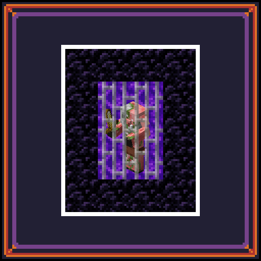

# Pigmen Begone and Jailed! (PB&J)

## Stops zombified piglins from spawning in nether portals

Ever spend time spawn-proofing the nether portal in your cozy base, just for a couple uninvited zombified piglins to lurk around?

That's thanks to a vanilla game mechanic that occasionally spawns piglins *inside* the nether portal (the nether side isn't always loaded, so this is implemented in order to create better immersion between dimensions).

This mod doesn't actual jail any pigmen... I just needed a word that started with J.